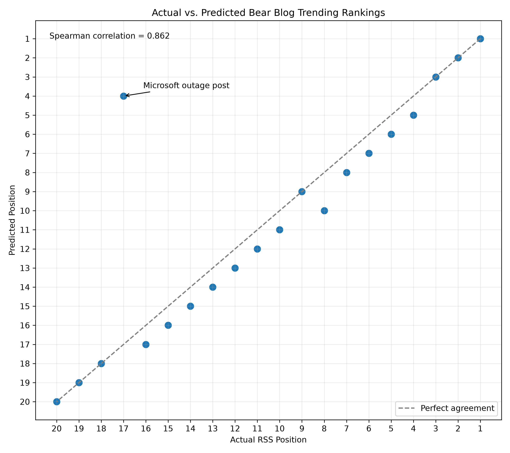

# Bear Blog Trending: Ranking Algorithm Analysis

## Research Question

**To what extent does Bear Blog's published ranking formula predict the ordering of posts in its Trending RSS feed?**

## Overview

This project examines whether Bear Blog's published ranking algorithm predicts the order of posts appearing in its Trending RSS feed. By collecting publication timestamps and upvote counts for the 20 posts in the feed, I reconstructed the published scoring formula and compared its predicted ranking against the actual RSS order.

The goal is to evaluate how closely the formula accounts for the ordering of trending posts and identify discrepancies between predicted and observed rankings.

## Data Collection

Data was collected from Bear Blog's public [Trending RSS feed](https://bearblog.dev/discover/feed/).

The feed provided post titles, URLs, and publication timestamps. Upvote counts were retrieved separately through the public `/upvote-info/` endpoint available on individual post pages.

- **Posts collected:** 20
- **Upvote counts retrieved:** 20 of 20
- **Missing upvote counts:** 0
- **Missing publication timestamps:** 0
- **Collection date:** November 15, 2026

The dataset represents a single snapshot of the Trending RSS feed rather than a longitudinal sample.

## Methodology

I reconstructed Bear Blog's published ranking formula:

```text
Score = log10(U) + S / (B × 86,400)
```

Where:

- `U` = number of upvotes
- `S` = seconds elapsed since January 1, 2020
- `B` = buoyancy modifier (3)
- `86,400` = number of seconds in a day

Using Python, I calculated a predicted score for each post and ranked the results from highest to lowest. I then compared the predicted positions with the posts' actual positions in the RSS feed.

To measure agreement between the two rankings, I calculated:

- Exact position matches
- Mean absolute rank difference
- Median absolute rank difference
- Spearman's rank correlation coefficient

The analysis was conducted in Jupyter Notebook using Python libraries including Requests, Feedparser, BeautifulSoup, pandas, NumPy, and Matplotlib.

## Preliminary Findings

The published formula closely approximated the ordering of Bear Blog's Trending RSS feed, although it did not reproduce the ranking perfectly.

| Measurement | Result |
|---|---:|
| Exact position matches | 7 of 20 |
| Mean absolute rank difference | 1.30 positions |
| Median absolute rank difference | 1 position |
| Spearman rank correlation | 0.862 |

The Spearman correlation indicates a strong positive relationship between the predicted and actual rankings.

One notable discrepancy was *"What I've learned from this Microsoft outage,"* which appeared at position 17 in the RSS feed but ranked 4th according to the reconstructed formula. Its 102 upvotes produced a substantially higher predicted score.

Overall, the results suggest that the published formula is a strong predictor of RSS ordering, but does not fully account for every position.

## Visualization

The following figure compares the actual RSS positions with the positions predicted by the reconstructed formula. The dashed diagonal represents perfect agreement between the two rankings.



*Figure 1. Actual RSS positions compared with positions predicted by Bear Blog's published ranking formula across 20 Trending posts. The strong positive Spearman correlation (ρ = 0.862) indicates substantial agreement, although several posts deviate from their predicted positions.*

## Limitations

- The analysis uses a single snapshot of 20 posts, so results may differ across collection dates.
- The Trending RSS feed is not necessarily identical to Bear Blog's public Trending webpage.
- Direct automated access to the Trending webpage returned HTTP 403 due to a Cloudflare challenge. The RSS feed was therefore used as the primary source.
- The formula was reconstructed from Bear Blog's published description. The analysis does not establish whether additional ranking factors or implementation details influence the final ordering.
- These findings demonstrate an association between predicted and observed rankings, not proof that the formula is the sole mechanism determining placement.

## Repository Contents

- `ranking_analysis.ipynb` — data collection, ranking calculations, statistical comparison, and visualization.
- `ranking
